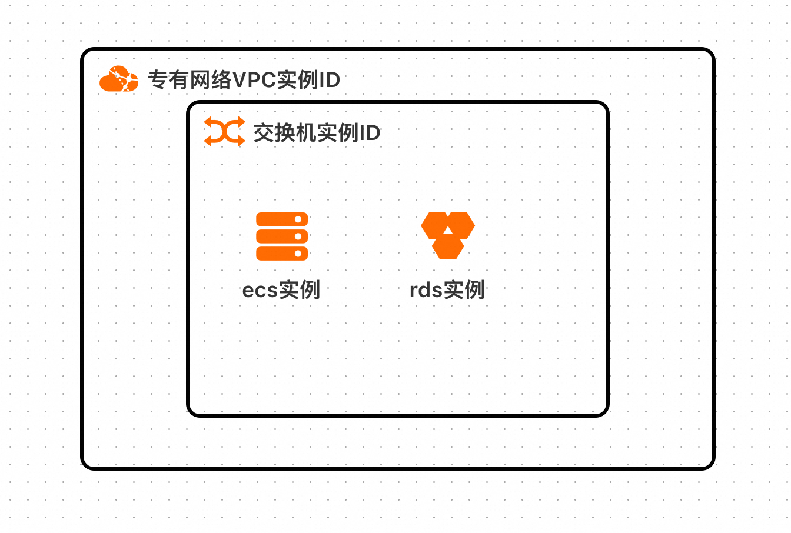
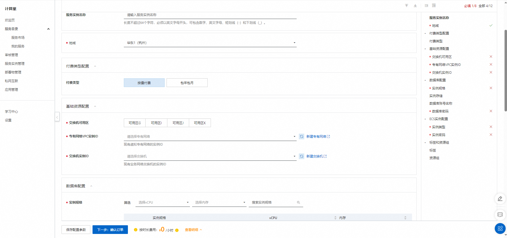
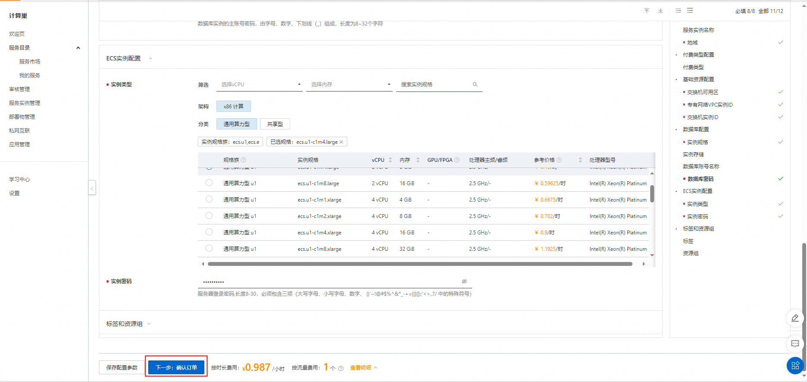
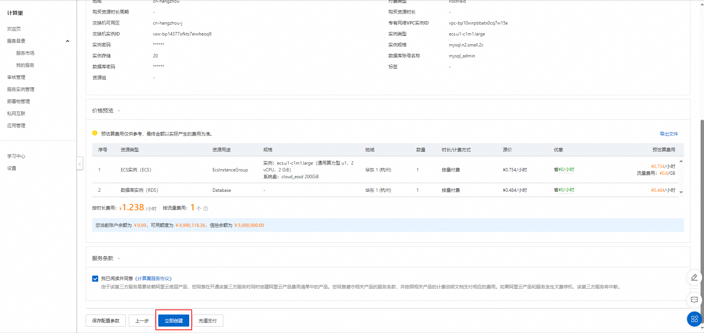
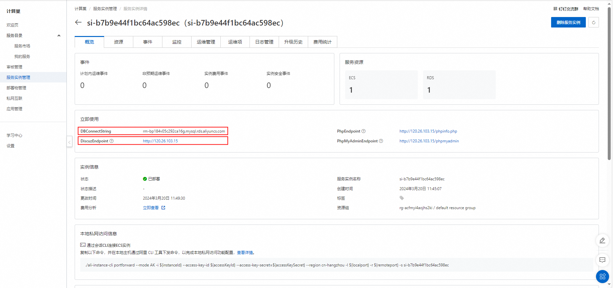

# Discuz! 计算巢快速部署

>**免责声明：**本服务由第三方提供，我们尽力确保其安全性、准确性和可靠性，但无法保证其完全免于故障、中断、错误或攻击。因此，本公司在此声明：对于本服务的内容、准确性、完整性、可靠性、适用性以及及时性不作任何陈述、保证或承诺，不对您使用本服务所产生的任何直接或间接的损失或损害承担任何责任；对于您通过本服务访问的第三方网站、应用程序、产品和服务，不对其内容、准确性、完整性、可靠性、适用性以及及时性承担任何责任，您应自行承担使用后果产生的风险和责任；对于因您使用本服务而产生的任何损失、损害，包括但不限于直接损失、间接损失、利润损失、商誉损失、数据损失或其他经济损失，不承担任何责任，即使本公司事先已被告知可能存在此类损失或损害的可能性；我们保留不时修改本声明的权利，因此请您在使用本服务前定期检查本声明。如果您对本声明或本服务存在任何问题或疑问，请联系我们。

## 概述

Discuz! 是一款通用的社区论坛软件系统，使用 PHP 编写，可用于快速搭建论坛、问答与社交类站点。更多信息，请参见 [Discuz! 官网](https://www.discuz.vip/)。

本文介绍如何使用计算巢部署 Discuz! 社区版服务实例。部署完成后，环境（Ubuntu 24.04 + Apache2 + PHP 8.3 + RDS MySQL 8.0）与 Discuz! X3.5 论坛均已自动装好，直接登录管理后台即可开始使用，无需再执行安装向导。

## 前提条件

部署 Discuz! 社区版服务实例，需要对部分阿里云资源进行访问和创建操作。因此您的账号需要包含如下资源的权限。

**说明**：当您的账号是 RAM 账号时，才需要添加此权限。

| 权限策略名称                          | 备注                         |
|---------------------------------|----------------------------|
| AliyunECSFullAccess             | 管理云服务器服务（ECS）的权限           |
| AliyunVPCFullAccess             | 管理专有网络（VPC）的权限             |
| AliyunROSFullAccess             | 管理资源编排服务（ROS）的权限           |
| AliyunRDSFullAccess             | 管理云数据库服务（RDS）的权限           |
| AliyunComputeNestUserFullAccess | 管理计算巢服务（ComputeNest）的用户侧权限 |

## 计费说明

Discuz! 社区版的费用主要涉及：

- 所选 ECS 实例规格（vCPU 与内存）
- RDS 实例规格与存储大小
- 系统盘类型及容量
- 公网带宽

## 部署架构

## 参数说明

| 参数组         | 参数项          | 说明                                                                       |
|-------------|--------------|--------------------------------------------------------------------------|
| 服务实例        | 服务实例名称       | 长度不超过 64 个字符，必须以英文字母开头，可包含数字、英文字母、短划线（-）和下划线（_）                          |
|             | 地域           | 服务实例部署的地域                                                                |
|             | 付费类型         | 资源的计费类型，支持按量付费与包年包月                                                      |
| 网络配置        | 可用区          | ECS 实例与交换机所在可用区                                                          |
|             | 专有网络 VPC     | 资源所在 VPC                                                                 |
|             | 交换机          | 资源所在交换机，需与上面所选可用区一致                                                      |
| ECS 实例配置    | 实例类型         | ECS 实例规格，可选 `ecs.u1`、`ecs.e` 系列                                          |
|             | 实例密码         | 服务器登录密码，长度 8~30，必须包含大写字母、小写字母、数字、特殊符号四类中的至少三类                           |
| 数据库配置       | 数据库实例规格      | RDS MySQL 8.0 实例规格                                                       |
|             | 数据库实例存储      | RDS 存储大小范围 20~2000，每 5 GB 递增，默认 20 GB                                    |
|             | 数据库账号名称      | Discuz! 连接 RDS 使用的账号名称，默认 `discuz_db`，小写字母开头，长度 2~16                     |
|             | 数据库密码        | RDS 账号密码，长度 8~32，由字母、数字与 `_-!@#$%^&*()+=` 组成                             |
| Discuz! 配置  | Discuz 管理员密码 | Discuz! 创始人账号 `discuz_admin` 的初始密码，长度 8~32，由字母、数字与 `_-!@#$%^&*()+=` 组成   |

## 部署流程

1. 访问计算巢 Discuz! 社区版[部署链接](https://computenest.console.aliyun.com/service/instance/create/cn-hangzhou?type=user&ServiceId=service-14fac3b46e2e4e52ba2c)，按提示填写部署参数。

   

2. 参数填写完成后可以看到对应询价明细，确认参数后点击**下一步：确认订单**。

   

3. 确认订单完成后同意服务协议并点击**立即创建**进入部署阶段。

   

4. 部署成功后进入服务实例详情页，在**输出**中可以看到以下地址与账号：

   | 输出 | 说明 |
   | --- | --- |
   | `DiscuzEndpoint` | 论坛首页地址，形如 `http://<公网IP>` |
   | `AdminUrl` | 管理后台地址，形如 `http://<公网IP>/admin.php` |
   | `AdminUsername` | 创始人账号，固定为 `discuz_admin` |
   | `DBConnectString` | RDS 内网连接地址 |

   

5. 打开 `DiscuzEndpoint`，论坛已经初始化完成，可以直接访问；无需再执行安装向导。

6. 打开 `AdminUrl`，使用账号 `discuz_admin` 与部署时填写的 **Discuz 管理员密码**登录管理后台，即可创建版块、发布主题。

## 已安装的软件与配置

| 组件 | 版本/说明 |
| --- | --- |
| 操作系统 | Ubuntu 24.04 LTS |
| Web 服务器 | Apache2 + PHP 8.3-FPM（proxy_fcgi） |
| 数据库 | 阿里云 RDS MySQL 8.0（内网连接，不占用 ECS 资源） |
| Discuz! | Discuz! X3.5 官方发布包 |
| 站点目录 | `/var/www/discuz` |
| 附件目录 | `/var/www/discuz/data/attachment` |

Discuz! 与 UCenter Server 的安装程序由镜像在构建阶段预置、部署阶段自动完成，数据库连接、创始人账号密码均已自动写入，用户无需手工安装。

## 默认安全配置

镜像与模板已完成以下加固，无需额外操作：

- `install` 目录禁止访问，避免论坛被重复安装；
- `config/config_global.php`、`uc_server/data/config.inc.php` 等配置文件不允许被直接访问；
- `data/` 目录（含附件、缓存、日志）禁止直接访问，且目录内禁止执行 PHP 脚本，防止上传后门；
- 保留 Discuz! 原生图形验证码，登录与发帖均需校验；
- PHP 配置 `expose_php = Off`，响应头不暴露 PHP 版本。

## 常见问题

**部署完成后访问 `DiscuzEndpoint` 打不开怎么办？**

部署完成后约 1~2 分钟内初始化脚本仍在执行，请稍等后刷新；若长时间无法访问，可在服务实例详情页查看部署日志确认初始化是否报错。

**忘记创始人密码怎么办？**

可登录 ECS 实例，用 RDS 账号连接数据库后修改 `pre_ucenter_members` 表中的密码字段，或重新部署一个新的服务实例。

**附件上传失败怎么办？**

附件目录为 `/var/www/discuz/data/attachment`，属主为 `www-data`。若自行修改过目录权限导致上传失败，可执行 `chown -R www-data:www-data /var/www/discuz/data` 恢复。

**能否绑定自己的域名并开启 HTTPS？**

可以。论坛默认使用 `http://<公网IP>` 访问，如需绑定域名与证书，可在 ECS 上自行配置 Apache 虚拟主机，或在前端接入负载均衡 / CDN 统一处理证书；绑定域名后请在管理后台**全局 → 站点信息**中同步更新站点 URL。

## 参考文档

https://help.aliyun.com/zh/ecs/use-cases/manual-build-discuz-bbs
